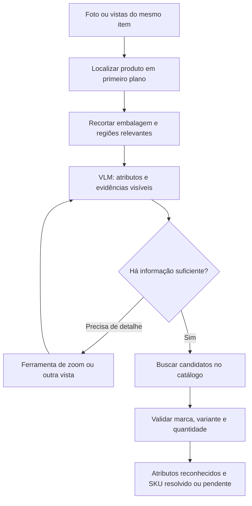

# Reconhecimento de produtos: pesquisa GitHub e nova proposta em cloud

Data: 26/10/2026. Escopo atualizado pelo usuário: GPU local deixa de ser o limite;
RunPod pode hospedar os experimentos. Esta é pesquisa e decisão experimental,
não uma implantação ou medição dos novos modelos nas nossas imagens.

## Diagnóstico que muda a direção

O objetivo real é reconhecer o produto segurado e seus atributos, mesmo sem
cadastro manual de imagens. O protótipo atual compara fotografias brasileiras com
IDs RPC estrangeiros e aplica OCR à cena inteira. Ele não tinha uma forma de
retornar uma identificação livre como marca/nome/variante/quantidade fora da galeria.
Além disso, a aceitação automática híbrida está desativada por projeto.

Portanto, zero aceitações nas 77 fotos não é uma taxa de acerto zero de um
reconhecedor universal: esse reconhecedor ainda não foi implementado. O ensaio
revelou leitura de fundo, associação incorreta de atributos e inadequação do catálogo.
Trocar somente a GPU não corrige esses problemas.

Recomendação: testar **VLM de maior capacidade + localização/zoom do produto +
extração estruturada de atributos**, comparando ferramentas dinâmicas com uma
pipeline fixa. Resolver o SKU em catálogo é uma segunda tarefa. Uma descrição
correta pode ser útil mesmo quando não há correspondência de SKU/preço.

## Repositórios verificados

### 1. Qwen3-VL e Qwen-Agent: principal base para o experimento

- [Qwen3-VL](https://github.com/QwenLM/Qwen3-VL): cookbooks de grounding, OCR e
  ferramentas visuais. É código/modelo multimodal, não um caixa pronto.
- [Qwen-Agent](https://github.com/QwenLM/Qwen-Agent): fornece o framework de chamadas
  de ferramentas e implementação de zoom. Código Apache-2.0.
- Inspeção concreta: [image_zoom_in_qwen3vl.py](https://github.com/QwenLM/Qwen-Agent/blob/main/qwen_agent/tools/image_zoom_in_qwen3vl.py)
  implementa `image_zoom_in_tool`, que recorta uma região delimitada por coordenadas
  e devolve uma imagem ao modelo. Não é apenas uma recomendação de prompt.

Usar essa capacidade para separar o item na mão e aproximar marca/quantidade.
O modelo precisa receber o recorte; pedir zoom em texto, sem executar ferramenta,
não aumenta a resolução que ele efetivamente vê.

### 2. Qwen3.8: candidato atual de maior capacidade

O repositório antigo Qwen3.5 redireciona atualmente para
[Qwen3.8](https://github.com/QwenLM/Qwen3.8). O
[Qwen3.8-27B oficial](https://huggingface.co/Qwen/Qwen3.8-27B) é multimodal,
Apache-2.0, oferece instruções de serving e o repositório documenta tool calling.
O cartão lista aproximadamente 28 bilhões de parâmetros em BF16.

Comparar esse checkpoint com Qwen3-VL-32B-Instruct. Ser mais recente ou maior não
comprova precisão superior para embalagem brasileira. Nenhum resultado específico
das nossas 77 fotos foi encontrado ou produzido nesta pesquisa.

### 3. OpenMPR: avaliação reproduzível, não solução universal

[upeee/openmpr](https://github.com/upeee/openmpr), Apache-2.0, publica avaliador,
resultados de referência e comparação no GroceryVision MPR. Os autores relatam
77,0% Recall@1 e 94,5% Recall@5 em 409 SKUs. A inspeção de
`src/benchmark/eval_openclip.py` confirma recuperação contrastiva com OpenCLIP.
Esse resultado não é um benchmark de um agente generativo Qwen com ferramentas.

Útil para reutilizar protocolo e avaliar recuperação. Continua dependendo de
catálogo candidato; os números não garantem o mesmo desempenho nas nossas fotos.
O código e o dataset têm termos separados: o dataset indicado é não comercial.

### 4. SKU Vision Pipeline: concorrente visual e referência de curadoria

[Sanket758/sku-vision-pipeline](https://github.com/Sanket758/sku-vision-pipeline)
tem código MIT, experimentos e pipeline DINOv3 + MobileNetV2. O autor declara
93,7% top-1 em 148 SKUs. A tabela apresenta 2.790 consultas para a pipeline e
940 para o baseline CLIP; não é uma comparação pareada que permita atribuir toda
a diferença à arquitetura.

Inspecionamos `experiments/curated_pipeline/pipeline_utils/matching.py`:
há um `SKURegistry` persistente com exemplos, centroides e memória entre imagens.
Logo, não é reconhecimento irrestrito sem referências. Serve como baseline com
catálogo e referência de curadoria. Licenças de modelos/dados devem ser conferidas
nas origens, independentemente da licença MIT do código.

### 5. GroundingDINO: alternativa para localizar antes de reconhecer

[IDEA-Research/GroundingDINO](https://github.com/IDEA-Research/GroundingDINO),
Apache-2.0, implementa detecção guiada por texto. Pode propor caixas para embalagens.
Localização não equivale a identificação de marca, variante ou tamanho.
Também precisa ser testado para escolher o item na mão em vez dos produtos da
prateleira. Comparar com o próprio grounding do VLM; não adicionar dois detectores
por padrão sem benefício medido.

### 6. RunPod worker-vLLM e vLLM: infraestrutura reutilizável

- [runpod-workers/worker-vllm](https://github.com/runpod-workers/worker-vllm), MIT:
  worker oficial para endpoints vLLM no RunPod Serverless.
- [vllm-project/vllm](https://github.com/vllm-project/vllm), Apache-2.0:
  serving e batching. A [documentação de tool calling](https://docs.vllm.ai/en/latest/features/tool_calling/)
  explica parsers e configuração por família de modelo.

Servir uma API não resolve reconhecimento e não executa automaticamente as funções
da aplicação. O backend precisa executar crop/busca e devolver seus resultados.
Compatibilidade de versão, checkpoint e parser deve ser testada e fixada.

## Referências que não entram como solução pronta

- [swd07/retail-shelf-detection](https://github.com/swd07/retail-shelf-detection):
  estudo de caso de VLM + recuperação e regras. O próprio README informa que código
  de produção e dados são privados; a árvore pública contém oito arquivos e apenas
  dois exemplos Python. Não classificá-lo como implementação de produção aberta
  nem transportar seu F1 para acurácia de SKU deste projeto.
- [NVIDIA Retail Shopping Assistant](https://github.com/NVIDIA-AI-Blueprints/retail-shopping-assistant):
  referência de agente multimodal sobre catálogo. É assistente de compras, não
  um reconhecedor de checkout validado nas nossas fotos. Containers, modelos e
  dados têm termos próprios; não assumir que todo o conjunto é permissivo.
- A [documentação Seeed de reconhecimento de produtos](https://wiki.seeedstudio.com/solutions/edge-product-recognition/)
  alerta que o embedder padrão de um pacote é falso/hash e que OCR reranking/VLM
  fallback ainda não estão implementados. Um diagrama com esses blocos não prova
  que o código os executa. Não entra como atalho pronto para a solução pretendida.

## Arquitetura proposta para comparação

Começar com três ferramentas: `crop_image(image_id, bbox)`,
`search_products(brand, name, variant, quantity)` e `get_product(candidate_id)`.
Uma quarta ferramenta pode selecionar outra vista do mesmo item quando a sessão
tiver essas imagens. Limitar chamadas e registrar evidências, latência e custo.

Saída estruturada sugerida: categoria, marca, nome, variante, quantidade, unidade,
trechos visíveis com referência ao recorte, `catalog_product_id` opcional e campos
ausentes/conflitantes. O valor de um campo ilegível é nulo, não uma estimativa de
memória. Reconhecimento de atributos e resolução de SKU têm métricas distintas.

Para uma Nutella, o sistema pode reconhecer a marca e o tipo de produto sem
resolver o tamanho. Ao receber outra vista legível, pode completar a quantidade.
Um resultado de busca de outro tamanho não autoriza substituir a quantidade da foto.

Tool calling é útil quando traz nova evidência: zoom real, outra vista ou catálogo.
Uma cadeia longa de raciocínio sobre o mesmo texto contaminado não acrescenta a
informação que está faltando. Essa é a razão para testar ferramentas contra uma
pipeline fixa com o mesmo VLM, não presumir que um agente será superior.

## Catálogo sem cadastro manual

Podemos importar dados existentes automaticamente e consultar bases externas.
[Open Food Facts / search-a-licious](https://github.com/openfoodfacts/search-a-licious)
é candidato para alimentos; [Open Beauty Facts](https://github.com/openfoodfacts/openbeautyfacts)
para cosméticos. Auditar cobertura brasileira, embalagens/quantidades e licença dos
dados e imagens. Essas bases não asseguram cobertura de todos os itens do ZIP.
Na API OFF, não assumir suporte a busca livre no endpoint v2: conferir a interface
de busca adequada e seus limites antes de implementar a ferramenta.

Identificar atributos de um produto sem cadastrar fotos é viável como objetivo de
VLM. Vincular o item ao SKU/preço exato exige dados do catálogo correspondente,
que podem vir do sistema da loja ou de importação automática. O preço do caixa vem
da loja; o modelo não o inventa. GTIN pode ser uma chave retornada pelo catálogo,
sem depender de ler ou bipar o código de barras da foto.

## Plano RunPod

Para investigação, começar com um Pod Linux e uma GPU de aproximadamente 80 GB,
vLLM, concorrência 1 e contexto limitado. Comparar os modelos sequencialmente.
Depois de medir qualidade, memória e latência, avaliar Serverless/worker-vLLM.
Isso evita introduzir cold start/autoscaling como variável do primeiro ensaio.

Orçamento de memória estimado, não medido: um modelo de cerca de 28B BF16 ocupa
aproximadamente 56 GB decimais apenas em pesos; um 32B, cerca de 64 GB, antes de
cache KV, visão e ativações. A escolha de 80 GB é ponto inicial para contexto curto
e uma consulta por vez, não garantia de qualquer resolução ou batching.

A [tabela pública RunPod](https://www.runpod.io/pricing) consultada em 26/10/2026
anuncia A100 80 GB a US$1,79/h e H100 SXM 80 GB a US$3,99/h para Pods. Uma janela
hipotética de duas horas custaria US$3,58 ou US$7,98 só de GPU nessas tarifas;
não é cotação garantida nem previsão da duração do ensaio. Disponibilidade,
armazenamento e demais cobranças precisam ser conferidos na configuração efetiva.
Nenhum Pod, endpoint pago ou upload das fotos foi criado por esta pesquisa.

## Experimento que seleciona a solução

1. Preparar rótulos independentes de marca, variante, conteúdo líquido e produto
   alvo nas 77 fotos; separar visível, ilegível e ausente. Rótulo para avaliação
   não é cadastro do produto como referência do reconhecedor.
2. Agrupar vistas do mesmo item físico. Essas fotos repetem produtos e cenário;
   não são 77 SKUs independentes. Não dividir aleatoriamente vistas semelhantes
   entre desenvolvimento e teste. Confirmar grupos e reservar produtos/capturas
   antes de ajustar prompts, regras ou ferramentas.
3. Comparar A: VLM direto; B: localização/crop + VLM; C: mesmo VLM com ferramentas
   de zoom/consulta. Usar os mesmos casos, checkpoints e limites de saída.
4. Medir acerto por campo, acerto conjunto, atribuição de texto ao item certo,
   campos inventados, cobertura, SKU exato quando houver catálogo, p50/p95 de
   latência, chamadas de ferramentas e custo por imagem/item resolvido.
5. Avaliar quadro único e várias vistas separadamente. Uma resposta correta com
   várias vistas não comprova o desempenho de um único frame na câmera do caixa.

Meta experimental proposta: pelo menos 95% de acerto conjunto nos atributos que
estiverem efetivamente visíveis, com taxa de campos inventados reportada. É critério
de seleção, não precisão já obtida. Um catálogo candidato pode tornar resolução
mais precisa, mas rejeição/ambiguidade continuam sendo avaliadas separadamente.
As 77 imagens servem para triagem, não para certificar precisão comercial elevada.

## Proveniência da pesquisa

Foram consultados README, cartões oficiais e trechos de código, sem executar
código dos repositórios pesquisados. Uma auditoria via API GitHub registrou
licença de código, branch, commit e árvore dos três projetos de domínio.
O snapshot local está em `artifacts/repository-research-2026-10-26/repositories.json`
no workspace desta conversa. Principais revisões verificadas:

| Repositório | Commit |
| --- | --- |
| upeee/openmpr | 12c4ff1d1e45f382c8e331cf314bf05d7c4aedef |
| Sanket758/sku-vision-pipeline | 0a4ea9bf6a2a22a4322278bf6e5e5ca0accf94bb |
| QwenLM/Qwen3-VL | 96588727e44c78b25ba03ea03b8e12f7e64fd0da |
| QwenLM/Qwen3.8 | 2ea10dc725823bf7c3e21ce8557cbe15245132ae |
| QwenLM/Qwen-Agent | 31a4d36d123688581a9e9744427272b33ce940e0 |
| runpod-workers/worker-vllm | 71d503e6080319e176e77b20515c4aaaf3426b8f |

Checkpoint de modelo e imagem de serving também precisam ser fixados no experimento;
o commit do repositório não fixa automaticamente os pesos publicados no Hub.
