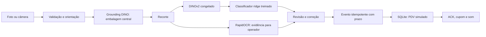

# Demonstração local assistida

Implementada em 27/10/2026 para apresentação de conceito. Não substitui um scanner
em produção. O plano comercial continua em [production-implementation-plan.md](production-implementation-plan.md).

## Executar nesta máquina

Na raiz do projeto:

```powershell
.\start-demo.ps1
```

Abra `http://127.0.0.1:8765`. Os artefatos treinados e as amostras já estão instalados
localmente em `artifacts/demo-training/`, fora do Git. Não há conta cloud ou cobrança.
O servidor aceita conexões apenas no loopback; não o exponha como serviço de produção.

1. Escolha uma foto reservada para teste ou envie uma imagem JPEG/PNG/HEIC.
2. Confira o produto localizado, os candidatos e a evidência OCR.
3. Confirme uma unidade. O simulador persiste a linha antes de devolver o ACK.
4. Apresente novamente para adicionar outra unidade, mesmo que seja o mesmo produto.

A captura por câmera está implementada, mas não foi testada com câmera física.
A seleção da amostra não fornece o rótulo ao reconhecedor. Toda inclusão exige
confirmação do operador. Preços uniformes de R$ 1,00 são fictícios; não há pagamento,
documento fiscal nem escrita no PDV real. O SQLite é apenas o journal do simulador;
a integração MySQL existente permanece separada.

## Arquitetura implementada



Grounding DINO tiny localiza uma embalagem na zona central; não é um detector
treinado especificamente para este caixa. Um classificador supervisionado ridge,
com contribuição balanceada por classe, aprende sobre embeddings DINOv2 ViT-S/14.
A regularização foi escolhida pela validação, sem ajustar pelos resultados do teste.
OCR lê o recorte e auxilia a revisão; nesta versão não altera o ranking visual.
Não há LLM, tool calling, leitura de código de barras ou precisão comercial demonstrada.

Reutilizamos FastAPI, PyTorch, Transformers e RapidOCR. Código/modelo DINOv2 e
revisão do detector estão fixados. Python 3.15 continua no projeto principal;
CUDA e OCR usam o ambiente isolado Python 3.12, compatível com as rodas instaladas
na RTX 5060. `uv.lock` de cada ambiente registra as dependências.

## Dados e resultados observados

- Fotos do usuário: 77 vistas de 11 produtos físicos, com rótulos/recortes revisados.
  Divisão fixa: 45 treino, 11 validação, 21 teste. Quatro vistas de perfil receberam
  caixas manuais para preparar dados; essas caixas não são fornecidas à inferência HTTP.
- Público RPC: 200 classes, 2.400 imagens de treino, 800 de validação e 800 de teste.
- Treinamento: 2.445 imagens, 211 classes. Imagens idênticas entre splits são bloqueadas
  por hash. Os 20 mil SKUs comerciais não estão cadastrados nem validados nesta PoC.
- Classificador com recortes preparados: **19/21** fotos do usuário e **441/800** RPC
  corretas no primeiro candidato. Top-3: 20/21 e 578/800, respectivamente.
- Fluxo HTTP com foto completa e localização real: **18/21** corretas; duas vistas
  de perfil não localizadas; um Bono confundido com Nikito. Localizou 19/21.
- Latência HTTP na instalação final: mediana **3,19 s**, p95 **6,84 s**, incluindo
  aquecimento e OCR, com outras verificações em execução. Na primeira execução:
  2,34 s / 5,73 s. Não atende à meta comercial de 500 ms; não confundir com cache.
- A inferência não criou nenhuma linha automaticamente. Confirmação e repetição do
  mesmo comando produziram uma única linha. Nutella foi reconhecida e confirmada
  também pela interface do navegador.

Esses testes usam vistas da mesma sessão e dos mesmos objetos físicos. Não medem
generalização para novas lojas, embalagens ou lotes. Há apenas uma apresentação
física por produto: o teste não comprova diferenciação entre tamanhos e variantes
da mesma marca. Atributos não verificados ficam ausentes no catálogo da PoC.
Não há calibração demonstrada para produtos desconhecidos; todos exigem revisão.
RPC tem restrições de uso em pesquisa e não é base comercial licenciada.

Evidências completas locais: `artifacts/demo-training/report.json` e
`artifacts/demo-training/http-validation.json`. O resumo versionado está em
[demo-validation-2026-10-27.json](demo-validation-2026-10-27.json).

## Reprodução

Os pesos, fotos, cache, banco e relatórios completos não entram no remoto. Para
reproduzir, é necessário o ZIP original e o dataset RPC instalado pelos comandos
documentados no README; o clone sozinho não contém esses dados.

```powershell
uv sync --locked
uv sync --locked --project experiments
uv run --locked --project experiments python experiments/import_demo_photos.py --zip "CAMINHO/fotos bixdata.zip"
uv run --locked --project experiments python experiments/train_demo.py
.\start-demo.ps1
# Em outro terminal, com o servidor iniciado:
uv run --locked --project experiments python experiments/validate_demo_http.py
uv run --locked pytest
```

`configs/demo-user-products.json` preserva rótulos, hashes, caixas normalizadas e
splits. O importador valida o ZIP e cada imagem sem extrair seus caminhos; recria
recortes e cenas JPEG. `bootstrap_boxes.py` e `prepare_demo.py` registram a etapa
exploratória de propostas/revisão; não são necessários para repetir as anotações
fixadas. Pesos públicos são baixados no primeiro uso e reutilizados em cache.

## Regressão e limites operacionais

Os testes cobrem separação de dados, aprendizado dependente dos rótulos, novidade
visual, compatibilidade de embeddings, recortes, importação segura, uploads,
limites de bytes/pixels, sessão, expiração, confirmação explícita, duplicação,
retries concorrentes e persistência do cupom. Não dependem de baixar modelos.
O teste HTTP separado usa modelos reais e as fotos reservadas.

Na instalação final: **131 testes passaram e 1 foi ignorado** (integração MySQL,
sem `TEST_DATABASE_URL` configurada). Ruff passou. Isso não constitui teste do PDV real.

A confirmação vence após três minutos; reenvie a foto se expirar. O servidor
serializa inferência e devolve 429 se ocupado. Usa limites de upload/pixels,
validação de Host/Origin e uma lista de amostras permitidas. Não há autenticação
multiusuário, alta disponibilidade ou hardening de produção. Falta homologar o
PDV e cumprir os gates de dados, segurança e operação do plano comercial.

O próximo avanço de precisão exige coletar famílias confundíveis com variações
de marca/peso, novas sessões e uma área de captura controlada. O erro de Bono e
as vistas de perfil permanecem no relatório; não foram removidos para elevar o acerto.
