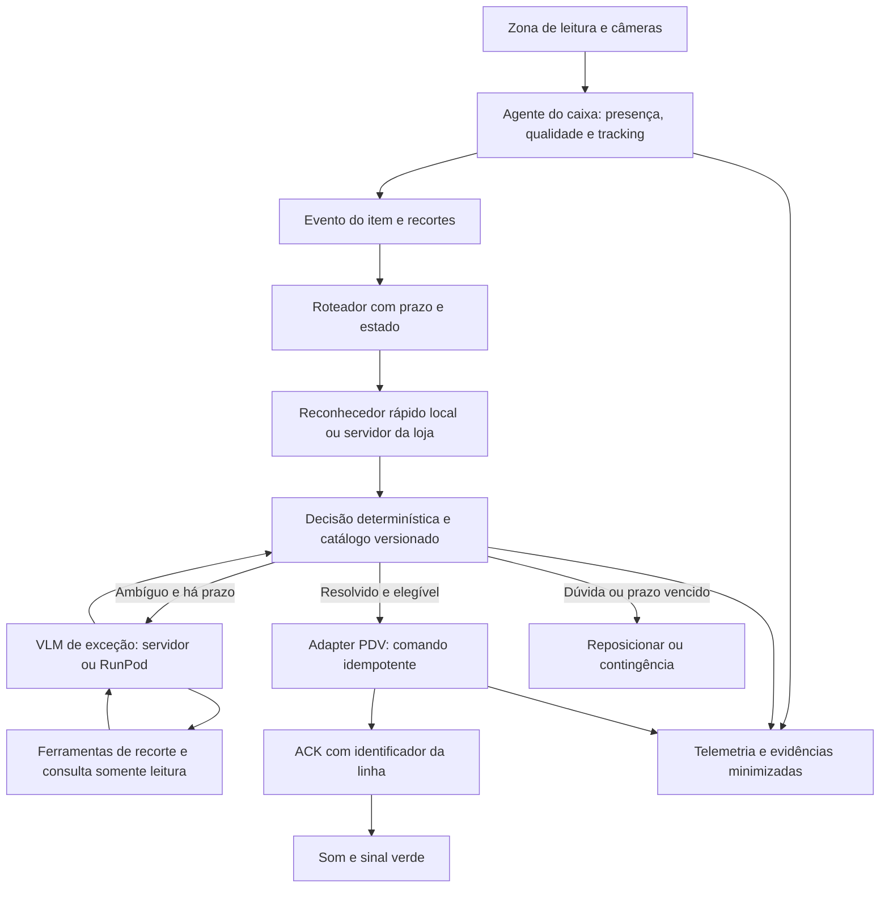

# Plano de implementação comercial — caixa por visão

**Data:** 26/10/2026. **Status:** plano proposto; nenhuma meta abaixo foi demonstrada
pelo protótipo atual. A liberação depende dos critérios de aceite, não do calendário.

Documentos complementares: [auditoria de segurança](security-audit-plan.md),
[backlog executável](implementation-backlog.md) e [pesquisa cloud](cloud-recognition-research.md).

## 1. Objetivo e cenário confirmado

Substituir a apresentação do código de barras no fluxo normal do caixa por uma
apresentação visual do item. O produto precisa resolver a identidade comercial,
lançar **uma unidade física uma única vez** e emitir o som de confirmação somente
depois da inclusão confirmada no PDV. O operador continua responsável pela compra;
não é um projeto de loja autônoma nem de substituição de pagamentos/fiscal.

| Informação | Base de planejamento |
| --- | --- |
| Protótipo | 1 caixa |
| Expansão | Aproximadamente 4 caixas por loja, 4 lojas: 16 caixas |
| Catálogo | Cerca de 20 mil SKUs; hipótese de mestre compartilhado com disponibilidade por loja |
| PDV/ERP | Desconhecido; identificar na primeira fase |
| Ritmo de pico | Hipótese: 30 itens/minuto/caixa, a medir na operação |
| Entrada inicial | Um item embalado, de venda unitária, por evento |
| Operação normal | Visão sem leitura de código de barras |
| Contingência | Scanner existente/seleção manual homologada, com indicação visível |

Os 20 mil podem representar a franquia ou cada loja; confirmar assortimentos,
sortimento sazonal e quantidade real ativa antes de comprar hardware. O projeto
não exige cadastrar manualmente fotos de cada produto, mas exige importar uma
identidade comercial confiável do ERP/PDV. Preço e promoção permanecem no PDV.

Os resultados anteriores — aproximadamente 56% top-1 RPC e 77 fotografias externas
sem rótulos — são evidência de laboratório. Não constituem validação comercial.

## 2. Contrato de acerto comercial

SKU certo com quantidade duplicada é erro; marca certa com tamanho errado também.
Medir por **evento físico de item**, e não por frame ou texto OCR.

| Indicador | Definição e meta proposta |
| --- | --- |
| Precisão automática | SKU e unidade corretos / inclusões automáticas; gate inicial restrito >=99,99%; alvo de expansão ampla >=99,999%, sujeito a orçamento de risco aprovado |
| Cobertura total | Inclusões automáticas / todos os itens apresentados; alvo comercial >=95%, discriminando famílias excluídas |
| Cobertura elegível | Inclusões automáticas / itens no escopo validado; complementar, nunca substitui cobertura total |
| Contagem | Duplicações e omissões por unidade física; zero falha conhecida de protocolo nos testes de aceitação; taxa real continuamente medida |
| Desconhecidos | Falsa aceitação de itens não disponíveis no catálogo/escopo; orçamento separado, inicialmente <=0,01% como alvo a validar |
| Rapidez | Caminho rápido p95 <=500 ms e p99 <=1 s, incluindo captura utilizável, fila, inferência e ACK do PDV |
| Exceção | Deadline proposto de 2 s; excedido, contingência. Metas não implicam que VLM remoto as cumpra |
| Disponibilidade | Meta inicial 99,95% para o serviço de leitura no horário de operação; perda do serviço não pode bloquear a contingência do PDV |
| Operação | Vazão, tempo de intervenção, devoluções, erro de estoque, sobrecobrança e subcobrança comparados ao scanner atual |

No protótipo, registrar também o tempo entre o item entrar na zona e a captura
se tornar utilizável. Essa espera não pode ser removida do tempo percebido pelo
operador. Estabelecer a linha de base de tempo/erros do scanner na própria loja.

### Por que uma porcentagem genérica não basta

Com 10 mil aceitações automáticas/dia, 99,9% corresponde a cerca de dez erros/dia;
99,99%, um/dia; 99,999%, 0,1/dia. Aprovar explicitamente o orçamento de erro e o
impacto, não apenas a porcentagem. Essas contas são cenários, não volume medido.

Para zero erros e limite superior unilateral binomial de 95%,
`n >= ln(0,05) / ln(1 - erro_alvo)`:

| Precisão a sustentar sob essas hipóteses | Aceitações sem erro |
| --- | ---: |
| 99,9% | 2.995 |
| 99,99% | 29.956 |
| 99,999% | 299.572 |

O [NIST descreve intervalos binomiais exatos](https://www.itl.nist.gov/div898/software/dataplot/refman2/auxillar/exacbino.htm).
O cálculo é nosso e pressupõe ensaios adequadamente independentes/representativos:
repetir frames do mesmo item ou só os SKUs fáceis não produz essa garantia.
Se houver erros, recalcular o intervalo; não apagá-los nem reiniciar a contagem.
Reportar resultados por família confundível, SKU, loja, turno, embalagem e operador.
Um agregado da franquia não comprova cada um dos 20 mil SKUs individualmente.

## 3. Escopo e limites físicos

Primeira automação: embalados unitários com identidade e aparência verificadas.
Uma área física de apresentação substitui a fotografia livre de prateleira.
O operador apresenta o item, recebe confirmação e o retira. Sem confirmação,
reposiciona ou segue a contingência.

Comparar uma e duas câmeras com iluminação difusa, distância, exposição e foco
fixos. Iniciar a avaliação com câmeras de 2–5 MP adequadas ao movimento, USB3 ou
interface industrial homologada; a compra depende de legibilidade e throughput
medidos. Capturar duas vistas complementares pode ajudar. Não supor que aumentar
a resolução do sensor compensa desfoque, reflexo ou rótulo oculto.

Sem vídeo contínuo na WAN: rastreamento local e seleção de poucos recortes por
evento. Verificar fluxo físico para duas unidades iguais, reentrada, devolução,
mão cobrindo rótulo, item transparente/reflexivo, vários itens e retirada antecipada.
Dois SKUs indistinguíveis na vista disponível exigem outra evidência ou intervenção.

Venda por peso, hortifruti/PLU, etiquetas de balança, multipacks, unidades avulsas,
embalagens danificadas e itens restritos terão protocolos próprios. Para pesáveis,
reutilizar a integração de balança/PDV homologada; visão não determina massa nem
conteúdo líquido pelo tamanho em pixels. Eventual hardware metrológico novo exige
avaliação específica antes de venda a peso. Não esconder essas categorias ao
calcular cobertura comercial.

## 4. Arquitetura funcional

O plano de controle central distribui catálogo, modelos, políticas, certificados
e relatórios. Ele não precisa participar de cada inclusão na venda. Cada loja
tem autonomia para seguir no modo homologado durante perda de WAN.

### Reconhecimento a comparar

1. VLM direto sobre o item, com saída estruturada.
2. Localização + VLM, isolando o produto da mão/prateleira.
3. Detector/tracker + encoder/classificador especialista adaptado ao catálogo,
   OCR localizado e regras de atributos.
4. Especialista como caminho rápido e VLM seletivo em casos difíceis.

Comparar mesmas consultas, orçamento de latência e critérios de rejeição.
Modelos iniciais de investigação: Qwen3-VL-32B, Qwen3.8-27B e modelos visuais
compactos supervisionados/métricos. DINOv2 congelado permanece como controle.
Uma arquitetura só passa se cumprir qualidade **e** vazão operacional.

O VLM pode sugerir marca, variante, quantidade e evidências; pode solicitar zoom,
outra vista da mesma sessão e candidatos do catálogo. Não cria SKU, preço,
quantidade de venda, promoção ou linha de carrinho. Ferramentas não autorizam
ações financeiras. Campos ausentes ficam ausentes; nutrição/preço de prateleira
não podem preencher conteúdo líquido.

## 5. Nível local: protótipo de um caixa

**Papel:** validar óptica, evento, qualidade e integração, além da inferência que
couber no equipamento. Reutilizar Ryzen 7 5700X, RTX 5060 de 8 GB e 16 GB RAM
no laboratório. Não considerar o PC homologado comercialmente sem teste.

Captura roda nativa no sistema suportado pela câmera/PDV. Serviços isolados via
Docker quando adequado; não depender de passthrough de câmera por WSL sem teste.
O controle pode permanecer em Python 3.15/uv; workers ML usam ambiente Python/CUDA
homologado, inicialmente separado, com contratos de rede para evitar acoplamento
de versões. Segurança, deadlines e formatos são iguais aos outros níveis.

Entregas: zona física, replay de vídeo, simulador PDV com ACK, máquina de estados,
catálogo importado, logs por evento, botão de contingência e benchmark sem cloud.
O modelo local pode ser menor e ter escopo automático restrito, com gate próprio.
Se não atingir precisão, opera apenas em sombra/sugestão; não diminuir limiares
para compensar hardware.

Este nível não oferece redundância por si só. Uma falha no PC não deve deixar o
PDV preso ao serviço de visão. Scanner e seleção manual permanecem disponíveis.

## 6. Nível RunPod: modelos grandes, treino e piloto cloud

**Papel:** comparar modelos, treinar/adaptar, curadoria e possível inferência de
exceção. Um Pod Linux com GPU de aproximadamente 80 GB é ponto inicial para
comparar os VLMs grandes sequencialmente, com contexto/resolução limitados.
O dimensionamento final depende de memória e eventos/s medidos, não só parâmetros.

Um piloto dependente de cloud é possível se cumprir a latência real da loja e
tiver contingência local. Não é a topologia padrão proposta para autonomia total.
Subir o modelo antes da abertura da operação e testar prontidão com inferência
real. Cache de pesos não é sinônimo de worker pronto.

Para serving, vLLM em container fixado e gateway próprio. Na etapa seguinte,
avaliar [worker-vLLM oficial](https://github.com/runpod-workers/worker-vllm).
A [documentação RunPod de load balancing](https://docs.runpod.io/serverless/load-balancing/overview)
explica o caminho direto HTTP sem fila/retry automáticos. O nosso gateway deve
implementar limites, health checks, backpressure e deadline. Não há retry cego
que autorize nova inclusão no PDV.

Manter workers ativos durante horários críticos e limitar custo/requisições.
As [configurações de endpoint](https://docs.runpod.io/serverless/endpoints/endpoint-configurations)
afetam ociosidade, escalonamento e disponibilidade: não aceitar configurações
padrão sem ensaio de rajadas e retomada. Uma nova GPU ainda pode levar tempo
para carregar; capacidade aquecida precisa suportar o pico previsto.

O agente do caixa não recebe chave administrativa RunPod. Apenas o gateway envia
recortes autorizados. Ambientes dev/homologação/produção têm credenciais distintas.
Contratar região/armazenamento e tratamento de dados conforme auditoria de segurança.
O [Global Networking de Pods](https://docs.runpod.io/pods/networking) não deve ser
confundido com LAN da loja nem com interconexão de GPU para tensor parallel.

## 7. Nível servidor: operação da loja e expansão

**Recomendação de produção:** inferência rápida na LAN da loja, compartilhada
pelos quatro caixas; cloud atende treino, controle e exceções com prazo.
Um servidor em datacenter remoto continua dependente da WAN e precisa da mesma
contingência do RunPod.

Começar a homologação com dois nós independentes por loja ou arranjo equivalente
de servidor mais edge validado. O nó sobrevivente deve sustentar a carga de projeto
sem relaxar a política de qualidade. Dois processos no mesmo computador não são
redundância contra sua falha. Evitar estado único em um gateway/load balancer.

Faixa inicial para ensaio, **não lista de compra**: Linux LTS suportado, CPU de
16–24 núcleos, 64–128 GB RAM, SSD NVMe com proteção/backup, GPU de 24–48 GB para
o reconhecedor compacto, UPS e LAN cabeada. Modelos grandes podem exigir GPU maior
ou continuar na cloud. Exigir benchmark e plano de peças/suporte antes da aquisição.

O catálogo local e políticas são versionados/assinados. Dados financeiros continuam
no PDV; coordenação de idempotência depende de persistência e do contrato PDV.
Replicação ou failover do MySQL não podem perder comandos e reaplicá-los como novos.
O PDV mantém a chave externa única ou permite reconciliação confiável da linha.
Dois nós de inferência não resolvem quórum de banco: qualquer failover automático
de estado com escrita deve ter arbitragem/quórum apropriado ou serviço gerenciado
homologado. Evitar dois primários após partição. O journal do caixa e a chave
idempotente reconhecida pelo PDV preservam a recuperação do comando.

Para quatro lojas, usar ambientes logicamente separados, distribuição central
de artefatos e operação por loja. Não centralizar o único caminho de venda numa
GPU remota nem impor Kubernetes antes de haver necessidade operacional demonstrada.

## 8. Roteamento de eventos e integração PDV

Máquina de estados mínima:

`EMPTY -> OBSERVING -> READY -> DECIDING -> SUBMITTING -> ACKNOWLEDGED -> EXITING -> EMPTY`

De `DECIDING`, pode ir a `NEED_VIEW`, `MANUAL` ou `EXPIRED`. Após `SUBMITTING`,
timeout não prova que a venda falhou: ir a `RECONCILING`, consultar o PDV e evitar
reenvio como nova unidade. Se não houver reconciliação, bloquear a reaplicação
automática e instruir o operador a conferir a venda antes da contingência.

Cada evento inclui `store_id`, `lane_id`, `sale_session_id`, `item_event_id`,
`request_id`, sequência, prazo e versões de modelo/política/catálogo. Retry de
inferência ou entrega mantém o mesmo `item_event_id`; duas unidades iguais recebem
eventos distintos. Nunca deduplicar apenas por SKU, imagem parecida ou janela de tempo.

Regras do roteador:

1. Aceitar uma apresentação ativa por caixa nesta versão.
2. Rejeitar cena vazia, múltiplos itens e qualidade insuficiente antes do modelo.
3. Resolver caminho rápido com catálogo/versões válidos e gate calibrado.
4. Encaminhar exceção somente se houver orçamento de tempo e worker saudável.
5. Usar no máximo um percurso remoto limitado, por exemplo duas chamadas VLM e
   duas ferramentas; o limite efetivo depende de testes de latência.
6. Se não terminar, sinalizar contingência. Nenhuma fila pode incluir itens tarde
   numa compra encerrada, em outro caixa ou após mudança da sessão.
7. Resposta expirada, evento cancelado ou versão incompatível é descartado.
8. Som/verde apenas após ACK da linha incluída; não após o modelo dar um palpite.

O adapter deve usar API/SDK/protocolo homologado do fornecedor. Emulação de teclado
USB pode ajudar um experimento, mas sem ACK, foco e idempotência não demonstra
inclusão correta exatamente uma vez. Se o PDV só oferecer isso, registrar a
limitação e manter automação comercial bloqueada até resolver o contrato.

O ACK deve confirmar a sessão, a identidade do comando, o SKU e o incremento
efetivamente aplicado. O PDV pode agrupar unidades iguais na mesma linha: receber
um `line_id` já existente, sozinho, não prova que uma unidade foi adicionada.
O fornecedor deve permitir distinguir retry do mesmo comando e nova unidade.

Uma unidade física de multipack não vira automaticamente `quantity=6`: ela é uma
unidade do SKU multipack. Cancelamentos, devoluções e alterações de quantidade
seguem o PDV e geram eventos auditáveis próprios.

## 9. Plataforma e fronteiras de responsabilidade

| Componente | Implementação proposta | Responsabilidade |
| --- | --- | --- |
| Captura por caixa | Agente nativo + OpenCV/SDK da câmera | Sensor, tracking, qualidade, estado físico |
| Gateway/adapter | Python/FastAPI, esquema versionado | Autenticação, prazos, elegibilidade, ACK/reconciliação |
| Inferência rápida | PyTorch; comparar ONNX/TensorRT após validação de equivalência | Detector, representação, atributos/score |
| VLM | vLLM + checkpoint/prompt fixados | Evidência complementar com ferramentas de leitura |
| Catálogo/controle | MySQL, migrações e histórico de versões | Mestre de identidade e snapshots por loja |
| Eventos por caixa | Journal/outbox durável; armazenamento local apropriado | Recuperação após crash; não é fila de cobrança tardia |
| Cache/filas | Memória/cache não financeiro; fila persistente apenas onde necessária | Backpressure e tarefas assíncronas, nunca fonte única de commit |
| Artefatos/imagens | Object storage compatível com S3, versionado e com acesso restrito | Pesos, índices, datasets e evidências com TTL |
| Observabilidade | OpenTelemetry, métricas e logs estruturados | Rastrear captura até ACK e resultado comercial |
| Deploy | Docker/Compose no laboratório; gestão homologada por loja | Builds imutáveis, saúde, atualização/rollback |
| Infra cloud | Infraestrutura como código e gestão de segredos | Provisionamento reproduzível, limites e separação de ambientes |

Não é necessário um microserviço por modelo ou um banco vetorial distribuído no
primeiro piloto. Um backend modular, workers GPU isolados e índice por versão
reduzem a superfície inicial. A interface permite trocar modelo/plataforma depois.

## 10. Catálogo, dados e 20 mil SKUs

Importar do ERP: SKU canônico, GTINs/aliases, nome, marca, variante, conteúdo e unidade,
pack count, família, unidade de venda, status e lojas elegíveis. Auditar duplicatas,
campos faltantes e conflitos. Versionar importação e quarentenar casos ambíguos.
O PDV continua fonte de preço, promoções e regras fiscais; não inferir esses dados.

Conteúdo líquido integra a identidade comercial; o
[padrão GS1 de gestão de GTIN](https://ref.gs1.org/standards/gtin-management/)
é referência para mudanças de quantidade/marca e identificação. Novas artes podem
ser aliases da mesma identidade, enquanto tamanhos e multipacks podem exigir IDs
distintos. Confirmar o mapeamento efetivamente usado pelo ERP.

Importar imagens/metadados de fabricantes, fornecedores e bases com direito de uso.
Open Food Facts pode enriquecer alimentos, mas não substitui o catálogo da loja
nem garante cosméticos, limpeza, embalagens atuais ou preços. OCR/VLM pode propor
rótulos para curadoria; não publica automaticamente verdade de treino ou catálogo.
RPC e conjuntos de pesquisa não são ativos comerciais liberados por padrão.

Estratégia incremental:

- Auditar todos os 20 mil IDs e famílias confundíveis.
- Começar por 300–500 SKUs de giro medido, incluindo seus vizinhos difíceis.
- Expandir para 1–3 mil e depois demais famílias, conforme curvas de aprendizado.
- Medir cobertura por quantidade de itens vendidos, além do número de SKUs.
- Novos produtos permanecem fora da automação até cumprir seu processo de admissão.
- Capturar dias, operadores, unidades físicas, câmeras, lojas e artes diferentes.
- Em sombra, obter verdade pelo scanner/ERP e revisão de divergências; o scanner
  é instrumento de teste, não entrada do modelo que pretende substituí-lo.
- Separar treino/calibração/teste por tempo/sessão e reservar loja/caixa para teste.
- Incluir desconhecidos, vazios, outros objetos, embalagens danificadas e pares
  quase iguais; testar com caixas previstas, não apenas recortes verdadeiros.

Não há quantidade universal de imagens por SKU que garanta o alvo. Como orçamento
inicial de coleta, avaliar dezenas de eventos diversos por SKU prioritário e
revisar após as curvas. Para 20 mil SKUs, direitos, qualidade e cauda longa são
parte central do trabalho, não uma etapa de download resolvida.

## 11. Escalabilidade e dimensionamento

| Cenário | Pico assumido | Rajada de projeto, 2x |
| --- | ---: | ---: |
| 1 caixa | 0,5 evento/s | 1 evento/s |
| 4 caixas / uma loja | 2 eventos/s | 4 eventos/s |
| 16 caixas / franquia | 8 eventos/s | 16 eventos/s |

Não enviar 30 frames/s por câmera como requisições independentes. Um evento pode
usar dois recortes e still images adicionais, mas continua uma unidade transacional.
Hipótese de upload: dois recortes de 200 KB, 0,4 MB/evento. Todos os eventos da loja
exigiriam cerca de 6,4 Mbps no pico e 12,8 Mbps na rajada; a franquia, 25,6/51,2 Mbps,
antes de overhead. Com 5% de exceções remotas, a média de imagens é menor; a rede
deve tolerar rajadas e alta taxa de exceção durante drift, não apenas a média.

Com 5% de exceções na franquia: 0,4 evento/s remoto; duas inferências por evento
correspondem a 0,8 requisição de modelo/s no pico normal. Esse é cálculo de carga,
não capacidade demonstrada de uma GPU ou garantia de deadline.

Dimensionar com `N_servindo = ceil(lambda_projeto / (mu_medido * utilizacao_alvo))`.
Usar, por exemplo, utilização planejada de até 60% para margem; `mu_medido` precisa
cumprir o p95/p99 na resolução/contexto reais. Reservar N+1 **por domínio de falha**:
um nó inteiro perdido, não só um processo. Após perda, a capacidade restante
continua >= carga de projeto, ou o excedente muda explicitamente para contingência.

Exemplo apenas ilustrativo por loja: se uma réplica sustentar 10 eventos/s no
SLO, a 60% há 6 eventos/s úteis, suficientes à rajada de 4; duas réplicas independentes
poderiam cumprir N+1. Se sustentar 5 eventos/s, há 3 úteis: são duas servindo e uma
de reserva. O benchmark, não esse exemplo, decide o hardware.

Catálogo não é motivo para carregar todas as imagens na VRAM. Oito vetores de
768 float32 por 20 mil SKUs ocupam aproximadamente 492 MB decimais só em vetores;
guardar índice em RAM quando adequado. Os arquivos de imagens e metadados são
dimensionados separadamente. Em quantização/exportação, revalidar qualidade e
gate; velocidade maior não autoriza regressão de identidade.

## 12. Produção, disponibilidade e contingência

| Falha | Comportamento exigido |
| --- | --- |
| WAN/RunPod fora | Caminho local/LAN homologado; exceções voltam ao operador |
| GPU indisponível/OOM | Roteador abre circuito e usa réplica/contingência; sem fila ilimitada |
| Servidor da loja fora | Nó sobrevivente ou modo local restrito já validado |
| Câmera/sensor falha | Não inferir item por memória; avisar e liberar scanner/manual |
| Catálogo inválido/conflitante | Bloquear resolução automática daquele escopo |
| ACK do PDV perdido | Reconciliar mesma chave; não reenviar como evento novo |
| Energia | UPS, persistência e retomada segura; reconciliação de eventos em andamento |
| Mudança de embalagem | Detectar drift, retirar família/SKU da automação e revalidar |

Oferecer botão físico/lógico de contingência por caixa e kill switch por loja,
sem depender de login cloud. Fallback após um comando de venda incerto requer
conferência da linha antes de um novo lançamento manual.

Metas propostas: restaurar automação por rollback em até 15 minutos; contingência
operável imediatamente quando não há commit incerto. Planejar RPO zero para
identidade/estado de comandos financeiros confirmados, ancorado no PDV, e RPO de
até 24 horas para cópias de imagens não financeiras, sujeito à política de dados.
Só declarar essas metas atingidas após ensaio de crash/failover/restauração.

Monitorar por loja/caixa: latência de cada etapa, idade da fila, exceções, cobertura
total/elegível, correções, duplicações/omissões, SKU/tamanho incorretos, falha PDV,
OOM, WAN, versão de pacote, custos e drift. Métrica do modelo em cache não é SLO.
No shadow mode usar verdade completa; em produção manter auditoria amostral e
reconciliação independente de vendas/devoluções/estoque para reduzir viés de feedback.

## 13. Segurança e auditoria como gates

O [plano de segurança](security-audit-plan.md) contém a revisão estática inicial,
ameaças, controles, evidências e critérios para pentest. Não é auditoria concluída
nem certificação. Antes de autorizar inclusão automática:

- Contrato de ACK/idempotência do PDV aprovado e ensaiado.
- Nenhum acesso financeiro pelo VLM/ferramentas.
- Credencial por dispositivo, segmentação, TLS, RBAC/MFA administrativo e segredos protegidos.
- Dados e modelos com proveniência e uso comercial permitido.
- Builds/artefatos assinados, hashes verificados e execução sem downloads arbitrários.
- Revisão LGPD e fornecedores, incluindo transferência internacional se aplicável.
- Pentest independente e exercício de perda de rede, GPU, servidor e restauração.
- Falhas críticas/altas do caminho transacional ou de dados resolvidas antes do gate.

## 14. Implantação e evolução

Ambientes separados: desenvolvimento, homologação com PDV de teste e produção.
Cada pacote de decisão fixa detector, encoder/VLM, pré-processamento, prompt,
ferramentas, esquema, índice, regras e calibração. Um evento mantém seu pacote;
atualização não mistura versões no meio do lançamento.

CI: testes unitários/contratos, replay de eventos, regressão visual, integração
MySQL/PDV, resiliência, SAST/dependências/containers e licenças. Carga e qualidade
com GPU são gates de release, não necessariamente de cada pequeno commit.
Builds com lockfiles/SBOM/proveniência; referência de cadeia:
[SLSA 1.2](https://slsa.dev/spec/v1.2/). Isso não implica certificação automática.

Rollout: sombra -> operador confirma -> allowlist limitada num caixa -> quatro
caixas da loja -> segunda loja -> quatro lojas. Não fazer A/B financeiro com
versão não aprovada; candidatos novos podem rodar em sombra. Canary usa apenas
pacote previamente homologado, com equipe e contingência presentes.

Rollback drena eventos, preserva commits e troca o pacote completo compatível.
Erro de SKU/tamanho conhecido bloqueia imediatamente o escopo afetado; incidente
sistêmico ou falha de idempotência desliga automação até investigação. Nunca
reprocessar inferências offline para incluir vendas antigas.

## 15. Cronograma, equipe e critérios de avanço

Estimativa para equipe de 4–6 profissionais equivalentes, com acesso ao mercado,
fornecedor PDV e dados: marcos em 20–32 semanas para automação comercial restrita
e início da expansão. A cobertura de 20 mil SKUs e o alvo estatístico amplo podem
exigir mais tempo; dependem de amostras, resultados e disponibilidade de operação.

| Fase | Janela de referência | Entrega / gate |
| --- | --- | --- |
| P0 — descoberta | Semanas 1–2 | PDV, catálogo, fluxo, risco, privacidade e SLO aprovados; viabilidade do adapter |
| P1 — captura e bancada | Semanas 2–5 | Um caixa/simulador, óptica e evento; comparação VLM/crop/especialista |
| P2 — dados e integração | Semanas 4–9 | 300–500 SKUs prioritários + negativos; catálogo, adapter e protocolo durável |
| P3 — sombra | Semanas 8–14 | Um caixa real sem escrita pela IA, vários turnos; precisão/cobertura/contagem/latência |
| P4 — assistido e hardening | Semanas 12–20 | Operador confirma; servidor/RunPod testados; pentest e recuperação |
| P5 — automação restrita | Semanas 18–26 | Gate estatístico inicial e orçamento de risco aprovados; um caixa em allowlist |
| P6 — expansão | Semanas 24–32+ | Quatro caixas, outra loja e depois quatro lojas; alvo amplo condicionado à evidência |

Papéis: produto/operação do mercado; engenharia ML/visão; backend/PDV; plataforma;
QA/automação de testes; segurança/privacidade e auditor independente. Pessoas podem
acumular papéis, mas quem ajusta o modelo não deve ser o único aprovador do teste final.
Um desenvolvedor sozinho demanda outro prazo e apoio especializado.

Gate inicial de 99,99% permite somente piloto automático restrito com risco
explicitamente aceito, nunca rotulagem de substituição comercial ampla. O alvo
de 99,999%, cobertura total e operação resiliente são critérios propostos para
expansão. Se não forem demonstrados, reduzir o escopo ou manter assistência.

## 16. Custo e compras

Não contratar uma frota GPU ou comprar quatro servidores antes de medir o protótipo.
O orçamento separa óptica/montagem, edge por caixa, servidor/UPS por loja, cloud,
integração PDV, coleta/rotulagem, segurança, suporte e conectividade.

`custo_cloud = horas_GPU * tarifa + armazenamento + rede + controle/serviços`.
`custo_por_item = custo operacional do período / itens resolvidos corretamente`.
Para sempre ligado, incluir 24h; para janela de operação, incluir inicialização,
validação de prontidão e atualização. Não calcular só pelos segundos de geração.
Como cenário, 1% e 5% de exceções multiplicam de forma diferente as chamadas;
ensaiar também 20% durante problema de embalagem/modelo e limitar gasto.

## 17. Primeiro ciclo de implementação

O [backlog](implementation-backlog.md) transforma o plano em entregas pequenas.
Começar por integração/simulador PDV, catálogo e captura controlada enquanto a
comparação de modelos roda no RunPod. Os primeiros gates de negócio são:

1. O produto certo pode ser identificado no tempo que o operador precisa?
2. Uma apresentação física resulta exatamente em uma linha confirmada?
3. O sistema recusa ambiguidade sem travar ou degradar o caixa?
4. A qualidade se mantém no catálogo e nas condições reais, com uso comercial permitido?

Nenhum recurso pago, compra de hardware, upload adicional ou lançamento no PDV
foi executado para produzir este planejamento.
