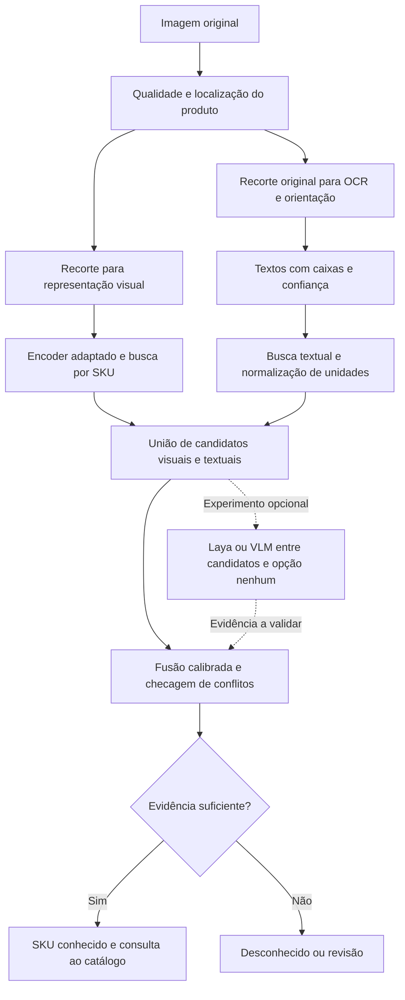

# Estudo de reconhecimento por SKU no hardware local

Data: 18/10/2026. Status: recomendação de arquitetura e protocolo experimental;
as alternativas novas ainda não foram treinadas nem medidas nesta máquina.

O protótipo usará somente datasets, sem cadastro manual de produtos. Portanto,
o catálogo conhecido deve ser importado automaticamente dos rótulos do dataset.
Reconhecer um SKU não significa reconhecer qualquer embalagem existente no mercado.

## Conclusão proposta

Construir uma comparação reproduzível entre reconhecimento visual especializado,
OCR isolado, fusão visual/textual e decisão com modelos de linguagem/visão.
A hipótese principal é que recuperação visual adaptada ao domínio + OCR de alta
resolução + fusão calibrada ofereça a melhor relação entre precisão e recursos.
Isso deve ser demonstrado por ablações, não adotado como resultado já provado.

Manter um caminho visual independente para hortifruti, embalagens sem texto legível
e casos em que o OCR falha. Tratar o modelo generativo como alternativa experimental
ou segunda análise dos casos difíceis; sua inclusão depende de ganho medido.

## Hardware e estado atual verificados

| Recurso | Leitura local |
| --- | --- |
| CPU | AMD Ryzen 7 5700X, 8 núcleos / 16 threads |
| RAM | 15,95 GiB instalados |
| GPU | NVIDIA GeForce RTX 5060, 8.151 MiB de VRAM reportados |
| GPU em uso na consulta | aproximadamente 1.146 MiB, compartilhada com o desktop |
| Driver | 610.88 |
| Disco C livre | aproximadamente 732,6 GB decimais |
| Runtime do projeto | Python 3.15, torch 2.14.1+cpu |
| CUDA no PyTorch instalado | build nulo; cuda_available=false |

O indicador CUDA 13.3 do nvidia-smi descreve a capacidade do driver; não comprova
toolkit instalado, compatibilidade dos wheels nem execução dos modelos na GPU.
A [NVIDIA lista a RTX 5060 na família de capacidade 12.0](https://developer.nvidia.com/cuda/gpus).
Validar suporte à arquitetura da placa no wheel escolhido e executar operações reais.

O projeto ainda não usa a GPU. CUDA acelera extração/treinamento, mas não altera,
por si só, as classes conhecidas ou a qualidade das referências.

## Diagnóstico do baseline

O DINOv2 ViT-S/14 está congelado; indexar não ajusta seus pesos. Cada consulta gera
um vetor global de 384 dimensões. O score de cada SKU é o maior cosseno entre
suas referências. O pré-processamento faz resize e recorte central de 224 pixels:
detalhes pequenos de marca/gramatura podem desaparecer e o produto pode ser cortado.
Não há detector, OCR, supervisão de variantes ou calibração estatística.

Na amostra RPC já avaliada: 389/800 primeiras sugestões corretas (48,6%);
93/800 aceitos, dos quais 86 corretos (92,5%). Foram 7 falsas aceitações e 707 revisões.
Esses números são de classificação com caixas verdadeiras e da amostra local,
não de checkout completo nem do benchmark RPC integral. Veja rpc-validation.md.

Banana e arroz enviados pelo usuário foram rejeitados. No arroz não houve
identificação do SKU brasileiro: os candidatos eram IDs do RPC, e não aquela
embalagem. Nenhuma arquitetura recupera a identidade exata de um catálogo ausente
apenas por aumentar o número de classes estrangeiras.

## Alternativas a confrontar

| Alternativa | Ganho possível | Falha importante | Papel no estudo |
| --- | --- | --- | --- |
| DINOv2 congelado + referências | Simples; novos SKUs entram pela galeria | Domínio genérico e detalhes pequenos | Controle atual |
| ResNet50 ou ConvNeXt-Tiny supervisionado | Aprende separações específicas do dataset | Exige treino; classes novas pedem atualização | Concorrente visual compacto |
| DINOv2 S/B adaptado, classificação e aprendizado métrico | Distingue pares parecidos e permite recuperação | Treino depende de diversidade e negativos difíceis | Principal candidato visual |
| DINOv3 S/B ou SigLIP2 visual | Outra representação pode separar melhor os produtos | Ser mais novo não comprova vantagem por SKU | Comparação com mesma galeria/protocolo |
| OCR + busca textual/TF-IDF | Marca e quantidade podem ser decisivas | Texto ausente, reflexo, oclusão e idiomas | Controle textual barato |
| Visual + OCR + fusão simples | Evidências complementares | OCR errado pode prejudicar decisão correta | Hipótese principal |
| Fusão aprendida de características | Aprende quando confiar em cada ramo | Pode sobreajustar e exigir mais dados | Comparar com fusão simples |
| Laya sobre texto e candidatos | Escolha restrita sem gerar texto | Não vê os pixels; depende da evidência recebida | Reordenador experimental |
| Laya-V / Laya Vision | Decisões visuais compactas | Calibração fora do domínio não é garantida | Concorrente experimental |
| VLM generativo compacto | Extração flexível de atributos e comparação | Pode inventar marca/tamanho e custa mais memória | Comparação direta e fallback |

O [DINOv2 padrão é Apache-2.0](https://github.com/facebookresearch/dinov2).
O [DINOv3 oferece S de 21M e B de 86M parâmetros](https://github.com/facebookresearch/dinov3),
com licença própria e processo de acesso aos pesos. Não usar o 7B como alvo local.
[SigLIP2 consta do repositório oficial big_vision](https://github.com/google-research/big_vision).
Essas opções são candidatas, não vencedoras medidas neste projeto.

Uma [avaliação publicada de imagem + OCR em produtos](https://link.springer.com/article/10.1007/s00138-024-01549-9)
encontrou benefícios de fusão; nela, concatenação de características foi competitiva
e mecanismos de atenção mais complexos não melhoraram os resultados escolhidos.
O estudo também mostra que uma CNN pode superar modelos maiores naquele regime.
Isso sustenta testar alternativas compactas em vez de presumir superioridade de VLMs.

### Laya não é LLaVA

O [Laya original](https://github.com/NandhaKishorM/laya) é um mecanismo textual de
decisões entre opções em uma passagem. Pode receber OCR e descrições de candidatos;
não deve ser confundido com um extrator visual nem receber milhares de SKUs de uma vez.

O [Laya Vision independente](https://github.com/r33drichards/laya-vision/blob/main/hf_model_card_score.md)
usa SmolVLM-256M, declara caráter experimental e licencia aqueles pesos como
CC BY-NC-SA 4.0. O [Laya-V](https://huggingface.co/henilchopada/laya-v) é outra
implementação; sua documentação registra confiança que não cai em imagens sem
informação útil. Logo, probabilidade retornada não basta para aceitar desconhecidos.
Não foi encontrada, nas fontes consultadas, validação desses candidatos no nosso
protocolo de SKU/variante. É preciso medir ganho, ordem das opções e casos sem evidência.

Para VLM generativo, incluir um candidato compacto como
[Qwen3-VL-4B-Instruct](https://huggingface.co/Qwen/Qwen3-VL-4B-Instruct), preferindo
quantização e execução isolada na comparação local. Seus pesos BF16 nominais
ocupam cerca de 8 GB decimais antes de ativações e cache: não é escolha segura
para coexistir sem quantização com toda a pipeline em 8 GB de VRAM.
Um modelo de 2B ou a versão 4B em 4 bits são hipóteses de viabilidade, sujeitas a
suporte do backend e medição. A conta de pesos não é uma estimativa de VRAM total.

## Datasets e o significado de marca/tamanho/variante

| Dataset | Uso recomendado | Limitação |
| --- | --- | --- |
| RPC já instalado, 200 SKUs | Primeiro experimento controlado e, depois, detecção | Produtos chineses; amostra atual tem apenas 12 referências por SKU |
| Unitail-OCR | Principal comparação de recuperação com leitura de embalagem | Galeria one-shot; não presumir disponibilidade de todos os atributos estruturados |
| Products-10K | Adaptação visual e teste de escala posterior | E-commerce; mudança de domínio para câmera; uso não comercial |
| RP2K | Alternativa posterior para produtos em prateleiras | Acesso, termos e mapeamento de variantes precisam ser auditados |
| Open Food Facts | Possível estudo futuro com embalagens e metadados brasileiros | Cobertura, duplicatas, qualidade e divisão de teste precisam ser construídas |

O [Unitail-OCR oficial](https://unitedretail.github.io/Unitail-OCR/) oferece 1.454
categorias na galeria, 10 mil consultas de matching, um subconjunto difícil de
2,4 mil exemplos e anotações de regiões/textos. É o próximo dataset mais alinhado
à comparação visual versus texto; não exige cadastro manual. Auditar seus termos
e as divisões antes de baixar/incorporar.

O [Products-10K oficial](https://products-10k.github.io/challenge.html) possui
10 mil SKUs e cerca de 190 mil imagens de e-commerce, com uso restrito a pesquisa
e educação não comerciais. O [artigo RP2K](https://arxiv.org/abs/2006.12634)
descreve mais de 500 mil imagens e 2 mil produtos. Maior diversidade não significa
que seja necessário baixar e treinar tudo para o primeiro experimento.

O RPC local mantém sua restrição de pesquisa CC BY-NC-SA 4.0.
Para [Open Food Facts](https://openfoodfacts.github.io/documentation/docs/Product-Opener/api/tutorials/license-be-on-the-legal-side/),
distinguir os termos do banco e das imagens; não tratar como dados sem condições.

Importar IDs, nomes, imagens e atributos existentes automaticamente. Campo de
marca/variante/quantidade ausente permanece nulo; não inventar verdade de referência
com um LLM. OCR das imagens de treino pode criar fingerprints textuais, não rótulos
independentes para certificar sua própria precisão.

SKU-level accuracy só prova separação entre os IDs anotados. Para afirmar que
separa 500 g de 1 kg ou dois sabores, o teste deve conter ambos, com rótulos
confirmados. Se o dataset agrupa tamanhos numa única classe, ele não serve para
medir essa distinção. Nomes genéricos do catálogo RPC local não provam atributos.

## Arquitetura candidata

1. Trabalhar inicialmente com um produto por consulta; dataset fornece as classes.
   Preservar proporção e testar padding em vez de recorte central. Localização
   automática deve ser avaliada separadamente das caixas verdadeiras do dataset.
2. Extrair representação visual do objeto. Comparar 224 versus aproximadamente
   384 pixels, respeitando o múltiplo do patch de cada modelo. Avaliar múltiplas
   vistas apenas quando existirem no protocolo, sem sintetizar um ganho de câmera.
3. Executar OCR na resolução original disponível. Detectar texto, corrigir
   orientação, reconhecer o idioma adequado e preservar caixas/confiança.
   Para RPC/Unitail, não limitar o OCR a português: testar leitor chinês/multilíngue.
   Para embalagens brasileiras futuras, usar leitor latino.
4. O [PaddleOCR disponibiliza modelos multilíngues e backend ONNX Runtime](https://github.com/PaddlePaddle/PaddleOCR/blob/main/docs/version3.x/module_usage/text_recognition.en.md).
   Comparar um modelo compacto e um de maior precisão, incluindo versões atuais,
   sem transferir latências publicadas em A100 para a RTX 5060.
5. Buscar top-K visual e textual de forma independente e unir candidatos.
   Não deixar uma classificação inicial de categoria eliminar o SKU correto.
   Medir recall@K: nenhum reordenador recupera um SKU que não entrou na lista.
6. Normalizar quantidades como 1 L = 1000 mL, preservando unidade e multiplicidade.
   Separar conteúdo líquido de peso, tabela nutricional, promoções e número de unidades.
   Ler 200 mL com boa evidência e encontrar candidato de 400 mL deve causar conflito;
   texto ausente não é evidência de incompatibilidade.
7. Começar com fusão interpretável: cosseno, votação/top-k de referências por SKU,
   score textual, coincidência de atributos, legibilidade, margens e ausências.
   Comparar regra simples, regressão logística/MLP pequeno e concatenação treinada.
   Treinar a fusão em uma divisão de desenvolvimento e calibrar em outra divisão,
   sem reaproveitar o teste final.
8. Laya/VLM recebem evidência e shortlist pequena, com saída restrita a IDs válidos
   ou nenhum. Não podem criar SKU/preço, completar texto ilegível como fato ou
   transformar a própria declaração de confiança em autorização de cobrança.
   Comparar também VLM sozinho: não assumir que a cascata é sempre superior.

Um modelo textual de raciocínio não cria informação que não está na imagem/OCR.
Explicações fluentes não comprovam a marca ou a quantidade. Seu valor deve aparecer
em menos erros e mais cobertura no conjunto reservado, descontando custo e latência.

Tamanho físico não é inferível com segurança a partir da área em pixels de fotos
com distância variável. Quando a gramatura não está visível, usar outras vistas
ou, em uma etapa com câmera, geometria calibrada/profundidade; balança pode dar
evidência adicional, mas peso bruto e conteúdo líquido são diferentes. Duas
embalagens indistinguíveis na vista disponível precisam permanecer ambíguas.

## Treinamento e orçamento de recursos

Começar pela extração congelada de DINOv2-S/B e uma CNN supervisionada compacta.
Treinar classificador pequeno sobre embeddings; depois comparar ajuste dos últimos
blocos ou aprendizado métrico com cross-entropy/ArcFace ou supervised contrastive.
Usar amostragem balanceada e negativos difíceis, sobretudo pares quase idênticos.
Evitar aumentos agressivos que apaguem o sabor, logotipo ou texto de quantidade.

Planejamento, ainda não medido: batch inicial 1–4, AMP FP16/BF16 conforme suporte,
acúmulo de gradientes e encoder pequeno primeiro. Acúmulo não reproduz todas as
propriedades de um batch grande em losses contrastivas; garantir múltiplos exemplos
positivos/negativos no batch efetivo ou avaliar fila de embeddings apropriada.
Não treinar detector, OCR e encoder simultaneamente na mesma GPU.

Reservar inicialmente cerca de 2 GiB de VRAM para desktop e margem operacional;
tratar 5–6 GiB de carga adicional como orçamento experimental, não garantia.
Medir pico do processo e ocupação total. Usar um worker de GPU com fila e inferência
sequencial; OCR/índice podem ficar na CPU se a curva de latência permitir.
VLM deve ser descarregado ou substituir temporariamente os outros modelos se necessário.
Os 16 GiB de RAM também limitam dataloaders, cache, Docker/WSL e modelos offloaded.

Uma galeria com 100 mil embeddings de 768 float32 ocupa aproximadamente 307 MB
decimais só para os vetores: não precisa ficar na GPU. Começar com busca exata em
NumPy/PyTorch CPU. Se a busca virar gargalo, comparar FAISS CPU; índice aproximado
exige medir perda de recall. MySQL guarda catálogo e versões, arquivos guardam
imagens/pesos, e índices são artefatos reconstruíveis.

Manter uv/MySQL/Docker. Usar uma aplicação modular com worker local, sem Kubernetes,
broker distribuído ou banco vetorial obrigatório para essa escala. MySQL deve servir
somente dados do catálogo, nunca inferir preço pela imagem.

Preservar o ambiente Python 3.15 existente como baseline. Para o laboratório de ML,
propor ambiente separado Python 3.12 via uv se o conjunto CUDA/OCR/quantização não
tiver wheels compatíveis com 3.15. Isso é proposta, não migração executada.
A [página de instalação PyTorch](https://pytorch.org/get-started/locally/) consultada
tem recomendações de Python que não refletem o wheel CPU 3.15 já funcionando aqui;
logo, conferir os artefatos reais do índice para cada combinação em vez de declarar
suporte ou incompatibilidade de toda a stack com base em uma única página.

Antes de instalar pacotes: resolver versões e drivers; testar CUDA, kernel de
atenção, modelo escolhido e OCR/ONNX com uma imagem. Fixar modelos por revisão,
lockfiles e checksums. GPU no Docker Windows exige validar WSL2/NVIDIA; para o
primeiro benchmark, Windows nativo evita adicionar essa variável.

## Experimento que decide a arquitetura

Primeiro congelar os splits. O teste RPC atual já foi observado várias vezes;
mantê-lo como comparação histórica, não como novo teste cego. Reservar novas cenas
antes de escolher modelos, limiares ou pares difíceis. Verificar hashes, duplicatas
visuais, cenas-fonte e, quando disponível, sessão de captura entre as divisões.

| Experimento | Pergunta |
| --- | --- |
| E0: baseline atual preservado | Qual é o ponto de partida? |
| E1: visual, recorte adequado + mais referências de treino | O problema principal era cobertura/pré-processamento? |
| E2: CNN e encoder adaptado | Quanto a supervisão por SKU melhora? |
| E3: somente OCR + busca/classificador | Quanto do problema pode ser resolvido por texto? |
| E4: E2 + OCR, fusão simples e aprendida | A multimodalidade supera os dois ramos isolados? |
| E5: Laya textual/variantes visuais e VLM compacto | Há ganho adicional sob a mesma memória e avaliação? |

Comparar os sistemas na mesma lista de consultas, com mesmas referências elegíveis.
Adicionar candidatos modernos somente se a primeira rodada justificar o custo.
Na triagem usar um seed; finalistas devem repetir treino com mais seeds.
Relatar busca de hiperparâmetros e custo, não selecionar o melhor seed retrospectivamente.

Medir acurácia top-1 e macro por SKU, recall@5/10, erros entre pares parecidos,
precisão entre aceitos, cobertura, taxa de aceitação de desconhecidos e curvas
risco-cobertura. Se atributos verificados existirem, medir marca, variante e
quantidade individualmente e o acerto conjunto; se não, declarar a métrica indisponível.
Reportar latência p50/p95, tempo frio/aquecido, VRAM, RAM e tempo de treino na máquina.

Incluir consultas de SKUs reservados que não participam de treino/galeria e objetos
fora do catálogo, além de imagens vazias/ilegíveis. Incluir opção nenhum num
classificador não comprova rejeição de desconhecidos. Calibrar com negativos de
desenvolvimento e testar com negativos distintos. Decidir limiares na validação;
comparar cobertura no mesmo alvo de erro, não com o mesmo cosseno entre modelos.

Um alvo inicial de engenharia pode ser >=99% de precisão entre aceitos e maximizar
cobertura, incluindo os negativos no protocolo. É uma meta, não previsão de resultado.
Usar intervalos de confiança. Como referência estatística, zero erros em cerca de
3 mil aceitações independentes dá limite superior unilateral de aproximadamente
0,1% para o erro a 95%; amostras correlacionadas e mudanças de domínio invalidam
essa leitura simples. Não prometer 99,9% a partir de poucas centenas de recortes.

Após escolher o reconhecedor de um item, estudar detector genérico de produtos
(por exemplo, [RF-DETR Small](https://github.com/roboflow/rf-detr), usando os
componentes/pesos com licença Apache-2.0). Detector localiza; reconhecedor distingue
SKU. Múltiplos itens exigem avaliar caixas previstas, oclusão, contagem, duplicação
entre frames e acerto do carrinho inteiro. Não herdar os números de caixas verdadeiras.

## Ordem de implementação e commits propostos

1. chore(ml): ambiente experimental CUDA isolado e diagnóstico reproduzível.
2. feat(dataset): protocolo com splits, desconhecidos e importação automática de IDs.
3. feat(vision): recorte que preserva o produto e baseline visual supervisionado.
4. feat(ocr): textos, caixas e scores persistidos, sem alterar a decisão padrão.
5. feat(recognition): fusão calibrada e rejeição de conflitos/desconhecidos.
6. feat(experiments): adaptadores opcionais Laya/VLM e ablações comparáveis.
7. docs(benchmarks): resultados, curva precisão/cobertura e decisão final.

Começar com RPC de forma controlada e ampliar as referências a partir do cache de
treino existente. Usar Unitail-OCR para validar o componente textual e o matching
difícil. Só depois expandir treinamento com Products-10K/RP2K, se o experimento
mostrar que a representação visual ainda limita o resultado.

Esta análise não muda dependências, pesos, galerias, limiares ou código do protótipo.
O próximo passo técnico é o laboratório de comparação, não implantar toda a
arquitetura como se sua superioridade já estivesse demonstrada.
